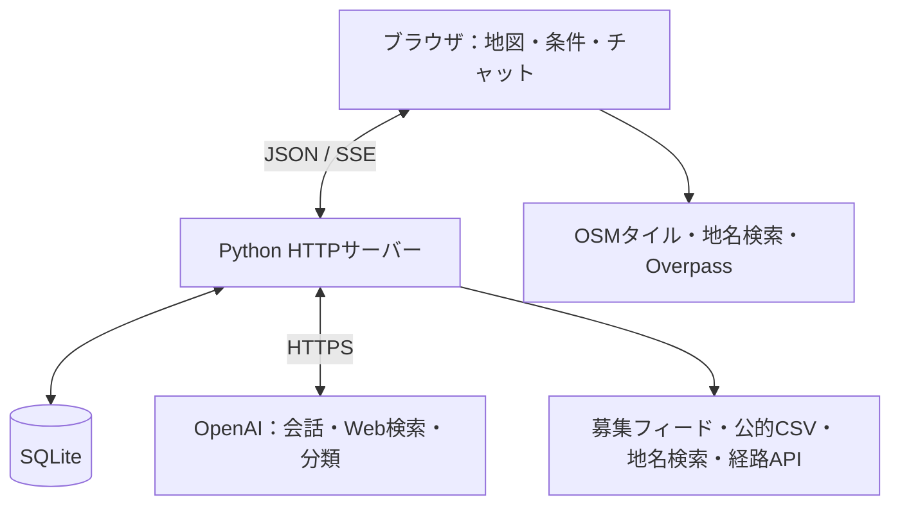

# Search Home — 会話と地図で住まいを探す

場所・予算・間取り・こだわりを伝え、掲載ページや公的住宅の情報を地図で確認しながら候補を比較・保存するローカルWebアプリです。日本語・英語のチャットと手動操作を組み合わせて使えます。

**AIが検索・操作を進め、プログラムが条件と根拠を確認します。** 建物の存在、掲載ページの発見、現在募集中であることを区別し、取得できない物件・家賃・空室情報を創作しません。

## 起動

Python 3.10以上が必要です。追加のPythonパッケージ、npm install、フロントエンドのビルドは不要です。

```bash
git clone https://github.com/syun88/DevDay_Hackathon_search_home.git
cd DevDay_Hackathon_search_home
python3 server.py
```

ブラウザで **[http://127.0.0.1:8765/](http://127.0.0.1:8765/)** を開きます。Linuxは `./start-linux.sh`、Windowsは `start-windows.bat` でも起動できます。

- **キーなし**：地図、場所検索、徒歩範囲、公的データ、掲載元リンク探索、許可済みデータの取り込み、手動比較が使えます。外部データ取得にはインターネット接続が必要です。
- **AIを使う場合**：`.env.example` を `.env` にコピーして `OPENAI_API_KEY` を設定し、サーバーを再起動します。Agents APIの利用権限とモデルの推論権限が必要です。AI・Web検索には利用料が発生します。
- **接続先に注意**：サーバーの既定ポートは `8765`、`.env.example` の設定は `8766` です。コピー後は **[http://127.0.0.1:8766/](http://127.0.0.1:8766/)**、または起動ログのURLを開いてください。環境変数は `.env` より優先されます。

## できること

| 機能 | できる操作 |
|---|---|
| 会話で検索・絞り込み | 「東京駅から3km以内、1LDK、月15万円まで」などの希望を整理して検索。「予算だけ変更」「直前の条件に戻す」にも対応 |
| 会話で地図を操作 | 検索結果全体を表示、候補に移動、ズーム、選択中の物件の既知の条件・不明点を説明。公的住宅の読み込みも依頼可能 |
| 起点A・Bの指定 | 住所・会社・駅名を検索、地図で指定、現在地を地点Aに設定。地点Bも使う場合は両地点の範囲で絞り込み |
| 徒歩範囲の表示 | 徒歩時間・徒歩距離・直線半径を切り替え、到達した道路・歩道と外周の目安を表示 |
| 条件比較 | 賃貸／売買、価格、間取り、面積、築年、ペット、駐車場、距離、道路の通勤時間。データがある項目だけ判定 |
| 掲載ページの探索 | Bing RSS／任意のBrave Search API。AIからのWeb検索と、通常の掲載元での検索に進む外部リンク |
| 公的住宅・自治体空き家 | 東京都の都営住宅団地CSV、津幡町の空き家CSV、許諾済み公的フィードを参考レイヤーとして表示 |
| 実在する建物の探索 | OpenStreetMapの集合住宅を周辺検索。建物データは賃貸募集とは別表示 |
| 候補・条件の保存 | チャットごとの条件・会話・明示した希望・「職場」などの場所・候補を保存。手動登録候補のCSV読み込み／出力も可能 |
| 操作の継続・切り替え | 複数チャット、下書き復元、途中回答とツール進捗の表示、停止・再試行、EN／JP切り替え、地図とチャットの高さ調整 |

## 使い方

1. AIキーを設定した場合は、チャットに希望を入力します。キーなしの場合は、左の「詳細設定」で場所・条件を指定します。
2. 条件チップで現在の設定を確認し、「掲載ページを検索」または会話から検索します。結果・保存済み候補は左のメニューから開けます。
3. 候補の地図位置・掲載元・分かっている費用と不明点を確認し、比較・保存します。
4. 追加の希望を伝えるか、条件を手動編集して再検索します。会話による条件変更でも、無関係な条件は保持します。

会話の入力例：

> 東京駅から直線3km以内、1LDK、管理費などを含めて月15万円以内の賃貸を探して。
>
> 予算だけ13万円に変えて、もう一度探して。
>
> 2番目の候補を地図に表示して、分かっている条件と不明点を教えて。
>
> その候補を保存して。直前の検索条件の変更は元に戻して。

チャットと条件チップの距離指定は**直線半径**です。徒歩時間・徒歩距離は「詳細設定」の地図機能で選びます。徒歩設定をチャットの距離条件と同一視しないでください。

現在地は、地図右上の上から3番目の **「⌖」**、または地点Aの「現在地」から取得します。操作時にだけブラウザへ要求し、許可が必要です。HTTPSまたはlocalhostで利用し、取得できない端末・ブラウザでは住所検索や地図指定を使ってください。

## 検索結果の読み方

| 表示する情報 | 根拠と限界 |
|---|---|
| 提供元が確認した募集データ | 許可済みJSON／CSV・フィードから取得。提供元の募集確認が1時間以内で、出典URLがあるものを採用。将来の空室は保証しない |
| Web検索で見つかったページ | 個別物件・建物・検索一覧・公的情報を区別。要約中の家賃等は未検証で、条件一致・空室確認とは扱わない |
| Bing／Braveの検索結果 | 掲載元へのリンク探索に使用。抜粋から推定した価格・間取りを確認済み募集に変換しない |
| 都営住宅台帳・自治体CSV | 公開資料の参考表示。資料基準日・ファイル更新日・取得日時・募集確認日時を分ける。台帳や空き住戸数だけでは募集中としない |
| OSMの建物・住所ピン | 建物の存在や住所の概略位置。正確な住戸位置、家賃、空室を示すものではない |
| SUUMO試作の候補 | 許諾を設定したときだけ取得する未確認の参考候補。範囲・全条件への適合や現在の空室は未確認 |

**賃貸予算は家賃＋管理費＋その他必須月額費用の総額**です。不明費用を0円にせず、未確認項目を初期状態で条件一致にしません。「条件が未確認の候補も表示」を選んでも、既知の不一致や期限切れの募集は一致候補になりません。売買では売買価格を比較します。

正確な座標がない候補は、厳密な距離・経路条件を確認済みにしません。Web検索で住所が得られた個別物件・建物ページは住所照合後に概略ピンを表示できますが、一覧ページを1軒の物件としてピンにはしません。**結果0件は、その取得範囲・データ源・確認条件での結果**であり、地域に物件が存在しないことの証明ではありません。

## 裏側の技術

### 全体構成



| 部分 | 実装と役割 |
|---|---|
| 画面 | HTML／CSS／素のJavaScript。地図のタイル配置・ズーム・ピン・SVG描画を自前実装。Reactや地図SDKへの依存なし |
| 地図計算 | Web Mercatorで座標を画面へ投影。直線距離はHaversine式、徒歩外周はGeoJSONのPolygon／MultiPolygonとして内外判定し、穴も除外 |
| ローカルAPI | Python標準の `ThreadingHTTPServer` と `urllib`。JSONの検索・セッションAPIと、SSEによる回答・進捗配信を提供 |
| 会話エージェント | OpenAI Agents APIをHTTPSで直接呼び出し。既定モデルは `gpt-6.1-sol`。`environment: none` で、アプリが定義したツールだけを実行 |
| AIのWeb検索 | Responses APIのhosted `web_search` とJSON Schemaを使用。検索で実際に参照・引用されたURLだけを採用し、ページ種別・数値・URLを検査。1メッセージの検索回数と取得件数も制限 |
| 補助分類 | Decisions API／`gpt-6-luna` でページ種別を分類する任意機能。募集の最新性・空室の証明には使用しない |
| 保存 | SQLiteが会話・共通検索条件・記憶・検索結果・候補の正本。ブラウザのLocalStorageは言語、徒歩設定、従来の手動候補などに使用 |

### AI APIの役割と短いデモ

- **Agents API：会話と操作の進行役。** 希望を整理し、条件更新・場所検索・掲載検索・地図操作・比較・保存など、アプリのツールを選んで実行します。同じセッションで会話の文脈を引き継ぎます。
- **Responses API：Web上の情報を探す役。** エージェントの `web_search` ツールから呼び出し、実際に検索で参照・引用されたページを出典付きで返します。
- **Decisions API：掲載文の種類を判定する役。** 候補カードの「AIで広告を分類」を押すと、タイトル・抜粋を「単一住戸の具体的な掲載／一覧・検索ページ／その他」に分類します。任意の補助機能で、空室や条件一致の判定はしません。

AIキーを設定した状態でのデモ手順：

1. 「東京駅の近くで1LDK、月15万円以内」と入力 → **Agents API** が条件設定と検索を進める。
2. 「Webでも探して」と追加 → **Responses API** のWeb検索で見つかったページと出典を確認する。
3. 許可済み募集JSON／CSVを読み込み、候補カードの「AIで広告を分類」を押す → **Decisions API** の分類を確認する。

家賃総額の計算・募集の鮮度・距離条件は、アプリのコードが検査します。

### ツール連携とMCPの位置づけ

**実装済み：Function callingによるツール連携。** [`home_agent.py`](home_agent.py) で操作と引数をJSON Schemaとして定義し、Agents APIが選んだツールをサーバーが検証・実行します。例えば `resolve_place` で場所を検索し、`update_search` で条件を更新、`search_listings` で候補を取得、`control_map` で地図表示を指示します。地図操作はブラウザの適用確認を待ち、保存などの更新は実行記録で二重処理を防ぎます。

**将来拡張：MCPで他のAIクライアントからも検索。** [Model Context Protocol（MCP）](https://modelcontextprotocol.io/docs/learn/architecture) は、AIアプリと外部のツール・データを接続する標準です。本アプリでは、地名検索や公的住宅検索をMCPサーバー経由で提供し、他の対応クライアントから再利用する拡張が考えられます。現時点ではMCPクライアント／サーバーは未実装で、接続デモもありません。

### 地理データと経路の使い分け

- **Nominatim／国土地理院**：会社・駅・住所から座標を検索。AIも取得済みの地点IDから起点を選び、座標を自由生成しません。
- **OSMタイル／Overpass**：背景地図と実在する集合住宅を取得。建物探索には照会半径・件数の上限があり、網羅検索ではありません。
- **Valhalla**：徒歩時間は5〜60分、徒歩距離は100m〜5km。Isochroneで外周、Expansionで到達道路網を取得します。徒歩速度は4.8km/hで、確定した探索区間のうち時間または距離の上限内だけを着色し、フェリー経路を除外します。
- **外周と道路の区別**：破線は外周の参考線、色付きの線は到達した道路・歩道です。外周内の川や土地を「歩ける面積」として塗りつぶしません。保存候補等の範囲判定は外周による概略判定で、入口までの個別経路の確認とは別です。
- **FOSSGIS／OSRM**：正確な座標を持つ候補から起点A・Bへの徒歩・自転車・車の道路経路を照会します。通勤条件には5分以内の経路結果を使い、経路なし・取得失敗を直線距離の推定時間で埋めません。

外部サービスへの操作は間引き・頻度制限・キャッシュで抑制します。徒歩条件を変えたら古い道路網を直ちに無効化し、遅れて届いた応答で新しい条件を上書きしません。公開サービスの停止・制限で失敗した場合は未判定と再試行を表示します。広い徒歩範囲の取得には時間がかかることがあります。

### 会話・地図・手動編集を一致させる仕組み

1. **共通状態**：会話と手動フォームは同じ検索条件を参照し、更新時にリビジョン番号を照合します。古いAIの処理や別タブが、新しい編集を黙って上書きするのを防ぎます。
2. **限定したツール**：条件更新、場所検索、掲載ページ検索、比較・保存、明示的な希望の記憶、公的資料の取得、地図操作などをサーバーで検証します。候補は結果セットID・物件IDで参照し、「2番目」をその時の表示順と照合します。
3. **実際の地図を確認**：ブラウザが表示範囲・選択候補・コマンドの適用結果を返します。指示を送っただけでは地図操作成功にせず、利用者の後からの移動・ズームを優先します。
4. **継続と復旧**：同じリモート会話セッションに文脈を保持し、ローカルには明示した希望・場所・履歴を保存。送信IDとツール結果を記録し、副作用と実行記録を同じSQLiteトランザクションで確定して、再試行時の二重更新を防ぎます。
5. **ストリーミング**：OpenAIからの回答断片・ツール進捗をSSEでブラウザへ配信。切断時は保存状態と照合し、途中回答を完成扱いにしません。停止・再試行・リロード後の復旧に対応します。

### 保存先と外部送信

会話・共通条件・明示的な記憶・候補は **`.local/sessions.sqlite3`** に保存します。チャットごとに検索結果は直近5セット、条件のUndoは直近20変更を保持します。従来の手動登録候補と徒歩設定はブラウザ保存なので、チャット保存や候補CSVと同じ範囲ではありません。

AIを利用すると、入力した会話、検索条件、明示的な記憶、検索結果や地図状態が処理の文脈としてOpenAIへ送られます。住所・地名は地理検索サービスへ、経路や徒歩圏の起点座標は経路サービスへ送ります。APIキーはサーバー側に置き、`.env`・DB・サーバーソースはHTTPで配信しません。

「会話と記憶を削除」は対象チャットのリモート会話セッションを削除してからローカル会話・記憶を消し、検索条件・保存候補を残します。「新しい検索」は条件も初期化します。別の履歴チャットは残ります。削除失敗は成功表示にしません。CookieはHttpOnly／SameSite=Strictで、同じブラウザプロファイルのタブはセッションを共有します。

## 設定とデータ接続

| 環境変数 | 用途 |
|---|---|
| `OPENAI_API_KEY` | 会話エージェント、AIからのWeb検索、任意のページ分類 |
| `OPENAI_AGENT_MODEL` | 新しく作るリモート会話のモデル。既定値 `gpt-6.1-sol` |
| `BRAVE_SEARCH_API_KEY` | 通常の掲載元リンク探索にBraveを追加。未設定時はBing RSS |
| `PORT` | ローカルHTTPサーバーのポート |
| `LISTINGS_FEED_PATH` / `LISTINGS_FEED_URL` | 許可済み募集JSONのファイル／HTTPSフィード。両方指定時はファイル優先 |
| `PUBLIC_HOUSING_FEED_PATH` | 許可済み公的住宅JSONの追加レイヤー |
| `VALHALLA_URL` | 徒歩APIの接続先を変更。自前運用のValhalla等に切り替える場合に使用 |
| `SUUMO_REUSE_PERMITTED` | 取得・再利用の許諾を得た運用者が `1` を設定した場合だけSUUMO試作を有効化 |

募集JSON／CSVは画面からも取り込めます。入力項目・単位・鮮度の契約は [募集データ仕様](docs/listing-feed.md)、公的CSVの接続範囲・出典・利用条件は [公的住宅データ](docs/public-housing.md) を参照してください。

<details>
<summary>SUUMO試作の範囲と仕組み</summary>

初期状態は停止し、サーバーも未許諾の取得を拒否します。環境変数の設定自体が利用許諾を取得するものではありません。起動に追加Pythonパッケージは不要ですが、この試作の通信には `curl` コマンドが必要です。

公開地図ページから匿名検索用の値をメモリ上で読み、東京都内の地図中心・半径0.1〜2kmに限って、家賃・間取り付きの地図検索を行います。ページ由来の値はブラウザやログに返しません。詳細設定の手動検索は1ページ20件でページ送りができ、チャット検索は先頭ページを使います。対応する取得済み物件だけ、掲載元の詳細表を読む機能もあります。

手動試作の家賃上限は**賃料のみ**です。チャットでは、対応する家賃の選択値へ照会範囲を広げても利用者の予算自体は変えず、判明した家賃＋管理費が総額予算を超える候補を除外します。ただしその他必須費用は不明なので、総額条件一致とはしません。

上流の座標は表示に使いません。チャット側で住所を再照合できた場合だけ概略ピンにでき、厳密な半径内・空室は未確認です。手動試作では面積・築年・ペット・駐車場・地点B等の共通フィルターは適用されません。戸建て種別の絞り込み、都内全域の網羅検索、公式な物件API連携ではありません。

</details>

## 現時点の制約

- **ローカル個人利用向け**：サーバーは `127.0.0.1` にのみ待ち受けます。認証付きの複数利用者向け公開サービスではなく、DBの自動保管期限処理もありません。
- **接続範囲**：公的CSVの標準接続は東京都と津幡町です。UR・JKK東京・全国版空き家バンクは公式サイトへのリンクで、全国の募集を自動収集しません。
- **未対応**：リアルタイム空室保証、電車時間による絞り込み、最新の渋滞・運休、災害レイヤー、初期費用の完全計算、自動新着通知。電車経路は外部のGoogle Mapsで確認します。
- **データと提供元に依存**：許可済み募集フィードや取り込みデータを用意しなければ、確認済み募集の在庫は接続されていません。Web検索・参考候補・掲載元リンクで探索できますが、価格・空室・条件は掲載元で最終確認してください。

## 開発・検証・詳しい設計

```bash
python3 -m unittest discover -s tests -v
python3 filter_core.py
node --test tests/*.cjs
```

Python標準のunittestとNode.js標準のテストランナーを使用します。`filter_core.py` の成功出力は `OK: distance/cost/unknown-field tests passed` です。GitHub Actionsでも同じコマンドを実行します。

テストは外部通信をモックし、鮮度・費用・座標、条件の競合、セッション分離、送信・ツールの再実行、地図の適用確認、Web検索の出典、ストリーミングと復旧などを検証します。公開サービスや実端末の位置情報が動くかどうかは別途ライブ確認が必要です。

実装を読む入口：画面と地図は [`index.html`](index.html)、会話・状態同期は [`chat.js`](chat.js)／[`workspace.js`](workspace.js)、AIのツール実行は [`home_agent.py`](home_agent.py)、APIとデータ接続は [`server.py`](server.py)、永続化は [`session_store.py`](session_store.py) です。条件判定は [`property_core.js`](property_core.js)、Web検索の検証は [`web_search.py`](web_search.py) にあります。

拡張案を含む設計は [ARCHITECTURE.md](ARCHITECTURE.md) を参照してください。記載されたReact／FastAPI／PostGIS等の将来構成は、現在の採用技術ではありません。
